# How Drydock Works — A Detailed Explainer

_Compiled 2026-10-26 from a scan of this repository (`poc/`, `research/`). All claims below are grounded in code paths cited inline; gate results and measurements cite the PoC plan and its battery scripts. The companion presentation is [`drydock-explainer.html`](drydock-explainer.html) (self-contained, with SVG flow diagrams)._

## 1. What Drydock is

**Drydock** (this repository, [`lalanikarim/drydock`](https://github.com/lalanikarim/drydock)) is a **coding-agent software factory**: a managed system that turns GitHub issues into reviewed pull requests without human intervention, with humans retaining the final decision at merge. The pipeline is *tickets in → sandboxed implementation → independent review → evidence on the PR → approval-gated merge*, and it runs unattended end to end.

It is built on **Pi Durable** (`@earendil-works/pi-durable`), whose durable conversations, sqlite-backed storage, task scheduler, and single-use approval documents are the factory's core primitives (see [`pi-durable-feasibility.md`](pi-durable-feasibility.md)). The implementation lives in [`poc/`](../poc/) (~4,000 lines of JavaScript across 12 library modules + 7 gate batteries), with shared libraries pinned as a git submodule at `poc/vendor/engram`.

The factory has passed gates **G0–G5** on a live fixture repo (status table in [`poc/README.md`](../poc/README.md)), and drydock is itself the first repo onboarded under its own management ("dogfooding") via `poc/config/lalanikarim-drydock.json`.

## 2. The cast: components and their files

| Component | File(s) | Role |
|---|---|---|
| **Webhook adapter** | `poc/lib/adapter.mjs`, `poc/lib/intake.mjs` | One reachable endpoint fronting N factories; verifies GitHub signatures *before* parsing, routes by per-repo secret, enforces sender allowlists, keeps a JSONL audit log |
| **Factory process** (one per managed repo) | `poc/lib/factory.mjs`, `poc/lib/factory-config.mjs` | Durable harness + root orchestrator conversation + HTTP surface (`POST /tasks`, `GET /health`, `GET/POST /approvals`, `GET /tool-results`, `GET /lessons`); loads and validates a per-repo JSON config at startup |
| **Orchestrator** (root conversation) | `poc/lib/factory.mjs` (`ORCHESTRATOR_INSTRUCTIONS`) | Reads only the *trusted directive line* of each submission; drives the fixed procedure via four tools: `delegate`, `open_draft_pr`, `merge_pr`, `note_lesson`. Never edits files, never follows `<untrusted>` content |
| **Worker** (durable task) | `poc/lib/factory-worker.mjs` | Host-side issue fetch + fresh clone on `agent/issue-<n>`; per-conversation Podman sandbox (`network=none`, no host env); deterministic prompt with the issue wrapped in `<untrusted>`; implements, tests, commits |
| **Reviewer** (durable task) | `poc/lib/factory-reviewer.mjs` | Independent, *structurally read-only* subagent: `read`, `git_diff`, `run_tests` (in sandbox), `submit_verdict`. Its verdict gates PR creation |
| **Draft-PR opener** | `poc/lib/open-draft-pr.mjs` | Host-side push + DRAFT PR (idempotent by head branch); host-verifies the test suite; assembles the evidence body. **Never merges** |
| **Merge gate** | `poc/lib/merge-gate.mjs` | Approval-gated `gh pr merge` with single-use durable approval records (`factory.merge-approval` doc family); exactly-once across crashes |
| **Lessons** (feedback loop) | `poc/lib/lessons.mjs` | Host-side markdown file (`data/lessons.md`) of standing lessons; written by `note_lesson`, read into every worker prompt at spawn |
| **Sandbox setup & health** | `poc/lib/setup-sandbox.mjs`, `poc/lib/sandbox-health.mjs` | Ephemeral networked setup container (deps install) before the sealed agent sandbox; liveness probe before every exec, dead-container detection + in-place recreation |
| **Fleet supervisor** | `poc/supervise.mjs` | Starts one factory per repo + the adapter from a fleet file; restart-on-fault with backoff and cap; read-only status table |

## 3. End-to-end flow

The complete lifecycle of one issue, from GitHub webhook to merged PR:

```mermaid
sequenceDiagram
    participant GH as GitHub
    participant AD as Adapter<br/>(lib/adapter.mjs)
    participant FA as Factory<br/>(lib/factory.mjs)
    participant OR as Orchestrator<br/>(root conversation)
    participant WK as Worker task<br/>(factory-worker.mjs)
    participant RV as Reviewer task<br/>(factory-reviewer.mjs)
    participant PR as Draft PR<br/>(open-draft-pr.mjs)
    participant HG as Human

    GH->>AD: issues.labeled ("agent") webhook + X-Hub-Signature-256
    AD->>AD: verify HMAC-SHA256 pre-parse (constant-time)<br/>route by matching per-repo secret<br/>check allowedSenders; JSONL audit line
    AD->>FA: POST /tasks { requestId: "issue-N", content }
    FA->>OR: rootConv.submit(...) — exactly-once by requestId
    OR->>WK: delegate({ issueNumber: N })
    WK->>WK: host: gh api fetch issue; fresh clone on agent/issue-N<br/>setup container (deps); sealed Podman sandbox (network=none)
    WK-->>OR: worker report (COMMITTED <sha> + test tail)
    OR->>PR: open_draft_pr({ issueNumber, title, summary })
    PR->>RV: independent read-only review of the branch
    RV-->>PR: verdict { pass|refuse, evidence, concerns }
    alt review refuses
        PR-->>OR: refusal + findings (no push, no PR)
        OR->>OR: note_lesson(…) — one standing lesson
        OR-->>HG: final answer presents verdict + concerns
    else review passes
        PR->>PR: host runs test suite; pushes branch;<br/>opens/updates DRAFT PR with evidence body
        PR-->>OR: prUrl
        OR->>FA: merge_pr({ issueNumber }) → REQUIRES APPROVAL + key
        FA-->>HG: GET /approvals lists pending key
        HG->>FA: POST /approvals { key, decision: "approved" }
        OR->>FA: merge_pr retry (identical args)
        FA->>GH: gh pr merge — approval consumed atomically,<br/>exactly one merge commit
    end
```

Key properties of the flow:

- **Deterministic wiring.** The orchestrator never sees raw issue text as instructions — only the trusted line `Work on GitHub issue number: N`. Issue content travels exclusively inside `<untrusted>` delimiters with an explicit do-not-follow wrapper (see `renderIntakeContent` in `poc/lib/intake.mjs` and `workerPrompt` in `poc/lib/factory-worker.mjs`).
- **Exactly-once intake.** GitHub redeliveries carry new delivery ids but the same issue, so `requestId = "issue-<n>"` makes dedup hold at the durable server's `submit()` (crash-verified; see design notes in `poc/README.md`).
- **Humans own the merge.** The agent can never self-approve: only the factory's `POST /approvals` endpoint writes a decision, and only the merge tool consumes it.

## 4. Intake and security (adapter → factory)

```mermaid
flowchart TD
    A[GitHub webhook POST /webhook/github] --> B{Raw body HMAC-SHA256<br/>checked against every configured<br/>per-repo secret, constant-time,<br/>BEFORE JSON parsing}
    B -- no matching signature --> X1[403 + audit line]
    B -- matches repo R's secret --> C{Event names a different repo?}
    C -- yes (cross-repo naming) --> X2[403 + audit line — gate M3]
    C -- no --> D{Sender on this route's<br/>allowedSenders list?}
    D -- no --> X3[403 + audit line]
    D -- yes --> E{isAgentIssueEvent?<br/>labeled "agent" or opened with it}
    E -- no --> X4[ignored, not an agent event]
    E -- yes --> F["renderIntakeContent:<br/>trusted directive line +<br/>issue inside <untrusted>"]
    F --> G[POST /tasks to the owning factory<br/>{ requestId: \"issue-N\", content }]
    G --> H[Durable server submit()<br/>dedup by stable requestId]
```

Details (all in `poc/lib/intake.mjs` and `poc/lib/adapter.mjs`):

- **Signature verification is mandatory off-loopback.** A valid `X-Hub-Signature-256` (HMAC-SHA256 of the raw body, constant-time compare) authenticates GitHub even behind a TLS-terminating proxy. Binding any non-loopback host without a secret refuses to start; loopback-without-secret is local-dev mode only (the G0 battery).
- **Secrets are per-repo, never global.** The adapter holds a `repo full_name → {secret, target}` map; the *matching* secret determines which factory receives the event, so signature validity doubles as per-repo authorization. An event signed with repo A's secret but naming repo B is rejected 403 (gate M3). Org-level webhooks are deliberately avoided — one leak would forge work into every factory.
- **Sender allowlists close the "who" gap.** A valid signature proves *GitHub* sent the event, not *who* on GitHub acted. Per-route `allowedSenders` restricts which logins may trigger the factory, checked after signature verification so the sender field is trusted data.
- **Fail-closed everywhere:** missing header, wrong prefix/length/digest → 403 + audit line; every decision (accepted or rejected) gets a JSONL audit entry for replayability.

## 5. The worker run (inside `delegate`)

Host-side preparation happens *before* the model sees anything (`poc/lib/factory-worker.mjs`):

1. **Fetch** the issue fresh via `gh api` (host, token from config/env).
2. **Prepare workspace** `work/issue-<n>/`: fresh clone (`--recurse-submodules` for pinned shared libs), branch `agent/issue-<n>`, local git identity set, credential scrubbed from the stored remote URL — the worker never pushes.
3. **Setup phase** (only if the repo config declares `setupCommand`): a one-shot *networked* container installs dependencies (`poc/lib/setup-sandbox.mjs`); state persists through the host-mounted workspace; the agent itself never runs in a networked container.
4. **Sealed sandbox**: one Podman container per worker conversation (image `factory-sandbox:latest`, node+git, `network=none`, no host env vars), routed to the conversation via the harness `env()` callback and torn down when the task settles.
5. **Deterministic prompt**: repo state, the issue inside `<untrusted>`, any standing lessons in a trusted section, and fixed working rules (stay on branch, smallest change, add tests, run the suite, commit only changed files).

Two supervision layers keep long runs healthy:

- **Wall-clock budget (M4)** — `budgets.wallSecsPerIssue` bounds each worker/reviewer run; on overrun the conversation is aborted cleanly, the sandbox torn down, the partial branch preserved for rework, and the overrun surfaced to the orchestrator as a `delegate` error plus an audit line.
- **Sandbox health (issue #20)** — every exec first probes the container (`podman inspect`); a dead `engram-sbx-*` container is detected, logged, and recreated in place (same name/mount/network), so a mid-run death no longer degenerates into silent retry loops until the budget (see `poc/lib/sandbox-health.mjs` and `test/sandbox-health.test.mjs`).

## 6. The reviewer gate (inside `open_draft_pr`)

The reviewer is **read-only by construction** — no write/edit/bash tools exist for its role (`poc/lib/factory-reviewer.mjs`):

- `read` — guarded file reads in the sandbox;
- `git_diff` — host-side `git diff origin/main...HEAD`;
- `run_tests` — the repo's test command *inside* the Podman sandbox (untrusted test code never runs on the host);
- `submit_verdict` — machine-consumable `{verdict, evidence, concerns}`.

It judges whether the change **actually satisfies the acceptance criteria**, not merely that the suite passes — a fix that passes its own tests but violates an acceptance criterion must fail (the fixture's issue #4 trap exists precisely to catch this). On refusal: no push, no PR; the orchestrator records at most one standing lesson via `note_lesson` and presents the verdict + concerns as its final answer.

On pass, `open_draft_pr` (`poc/lib/open-draft-pr.mjs`) does all GitHub writes from the **host**: host-verifies the test suite (parsing `# tests/# pass/# fail` counts for `node --test`), pushes the branch (replacing a diverged factory-owned remote branch with `--force-with-lease` only), opens or refreshes the DRAFT PR, and assembles an evidence body of host-verified facts: diff stat against merge base, suite counts, reviewer verdict, worker report. It is idempotent by head branch — retries return the existing draft PR instead of duplicating it. **It never merges.**

## 7. The merge gate (Phase 4)

`poc/lib/merge-gate.mjs` implements exactly-once merging under a durable human decision:

```mermaid
stateDiagram-v2
    [*] --> RequiresApproval: merge_pr({issueNumber}) first call<br/>stable key = sha1(tool + canonical args)
    RequiresApproval --> PendingApproval: agent reports key, stops;<br/>key visible via GET /approvals
    PendingApproval --> Consumed: human POST /approvals {key, approved};<br/>agent retries with identical args —<br/>tool atomically consumes the record<br/>in the same commit as the merge decision
    Consumed --> Merged: gh pr merge → exactly one merge commit
    PendingApproval --> Rejected: human decides "rejected" — no merge
    Consumed --> RequiresApproval: any further identical call needs a fresh approval
    note right of Merged
        Crash-safe either way: crash after consume,
        before merge lands → PR-state check makes a
        re-approved rerun a no-op (alreadyMerged)
    end note
```



- The approval record is a durable document (`factory.merge-approval` doc family), **single-use**: it is written only by the human-facing `POST /approvals` endpoint and consumed only by the merge tool.
- The agent cannot self-approve, cannot re-use an approval, and cannot bypass the gate — merging exists in exactly one code path.

## 8. The feedback loop (Phase 5)

Lessons are a **host-side markdown file** (`data/lessons.md`, `FACTORY_LESSONS_FILE`), deliberately *not* a durable doc: per-run sqlite databases are wiped between battery runs, but standing lessons must outlive them (`poc/lib/lessons.mjs`).

- The orchestrator's standing instruction: whenever a review is refused, **first** call `note_lesson` with one imperative sentence generalizing the finding, *then* present the finding.
- Every future worker prompt includes the lessons file in a trusted section at spawn — outside `<untrusted>`, but explicitly subordinate to the issue's acceptance criteria.
- Writing the lessons file is the only agent-reachable write outside the sandbox; it has no external side effects and is idempotent per identical line.

Verified closed loop (G5, `06-feedback-g5.mjs`): with no lessons, a worker reproduced a known handler-patch mistake; after one recorded lesson, the re-run fixed the bug at the root (e.g., giving the error class a `statusCode` instead of patching the catch site) — strong attribution that the loop works.

## 9. Multi-repo operation and supervision

- **One adapter, N factories.** `lib/adapter.mjs` is stateless (audit log only); dedup lives at each factory's durable server. The fleet file (`poc/fleet.example.json`) names one config + port + sqlite db per managed repo.
- **Per-repo config, validated at startup** (`poc/lib/factory-config.mjs`): repo identity, sandbox image, `setupCommand`/`testCommand` (argv-only — rejected if they contain shell metacharacters), budgets. A config file always wins over the legacy env fallback; schema violations fail fast.
- **Fleet supervisor** (`poc/supervise.mjs`): starts every factory + the adapter from the fleet file; restart-on-fault with backoff and a cap (safe because the durable harness recovers in-process state from its sqlite db); `status` fans out to each factory's `/health`, `/approvals`, `/tool-results` and prints one operator table.

## 10. Evidence: gates, measurements, and what's verified

| Gate | What it proves | Result |
|---|---|---|
| G0 (`01-intake-g0.mjs`) | Exactly-once intake under simulated retry; untrusted delimiting; signature checks (valid/missing/wrong/tampered); multi-repo routing + M3 cross-repo rejection; sender allowlists. No GPU needed — it is this repo's own test entry point | PASS, 20/20 checks |
| G1 (`02-orchestration-g1.mjs`) | Issue → draft PR unattended (361s, zero intervention) | PASS |
| G2 (`03-worker-quality-g2.mjs`) | Bounded issues produce passing, scoped PRs with zero human edits | PASS 3/3 |
| G3 (`04-reviewer-g3.mjs`) | Trap caught with the correct reason; good branch passed; closed loop through the review gate | PASS 3/3 |
| G4 (`05-merge-gate-g4.mjs`) | Evidence complete on PR; single-use durable approvals; SIGKILL while approval pending → restart → approve → exactly one merge commit | PASS (T1 143s / T2 144s) |
| G5 (`06-feedback-g5.mjs`) | One verifiable "same mistake doesn't recur" after a recorded lesson | PASS (306s) |
| Phase 6 (`07-measurement.mjs`) | Per-issue tokens by role, wall time, tool calls | Bounded issues run 129–433s at ~81–145K total tokens on local inference |

Measured sizing and risk notes (local-model quality on long-horizon coding; experimental API) are in [`poc-plan-factory.md`](poc-plan-factory.md).

## 11. Dogfooding: drydock manages itself

Drydock is its own first managed repo (`poc/config/lalanikarim-drydock.json`): `setupCommand: npm ci --prefix poc`, `testCommand: node poc/01-intake-g0.mjs`. Clones for drydock issues use `--recurse-submodules` so the pinned engram libs are present. Remaining pre-first-self-PR steps are GitHub-side human actions (webhook secret + webhook + branch protection on `main`) — see the self-management section of `poc/README.md`.

## 12. Design principles, in one breath

1. **Untrusted data is delimited and never executed** — issues enter only inside `<untrusted>` with an explicit do-not-follow wrapper; credentials stay host-side.
2. **The orchestrator is a fixed procedure, not a free agent** — four tools, deterministic wiring, minimal model judgment in the plumbing.
3. **Every external write is host-side and gated** — push/PR by `open_draft_pr` (draft only), merge by an approval-gated tool with single-use durable approvals; humans own the merge.
4. **Crash-durability is a first-class property** — exactly-once intake, crash-safe approvals, restart-on-fault supervision all verified under SIGKILL.
5. **Fail closed, audit everything** — signature checks before parsing, 403 + audit line on every rejection, budgets that abort cleanly and preserve partial work.
